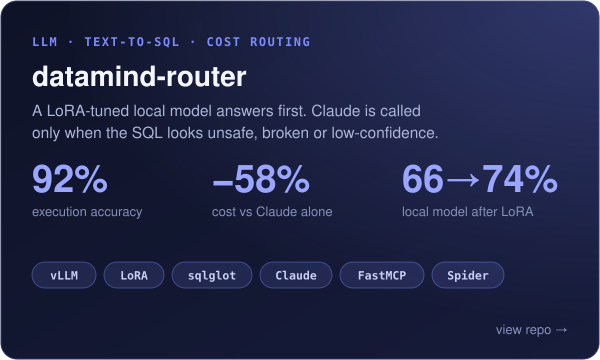
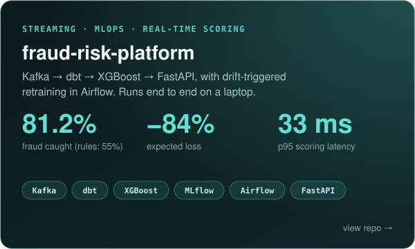

  

  
  
  

## About me

I build machine-learning systems end to end, from the data pipeline to the model to the API that serves it, and I benchmark every one against a baseline.

- Every result comes with its **cost, latency and limitations** next to the accuracy.
- I like problems where **engineering decisions change business outcomes**: dollars of fraud caught, or API spend per 1,000 queries.
- Everything I ship has **tests, reproducible runs and a one-command quickstart**.

## Featured projects

<table>
  <tr>
    <td width="50%" valign="top">
      
    </td>
    <td width="50%" valign="top">
      
    </td>
  </tr>
  <tr>
    <td valign="top">

**[datamind-router](https://github.com/saadms111/Datamind_router)**: a Text-to-SQL agent that answers locally and calls Claude only when it has to.

- **Cascade routing:** a LoRA-tuned Qwen2.5-Coder-1.5B (vLLM) answers first. A confidence threshold on mean token logprob decides when to escalate to Claude.
- **Safe by construction:** sqlglot AST guardrails and a read-only SQLite executor. Only the normalized SQL is executed.
- **Honest benchmarks:** a Spider dev subset, scored for execution accuracy, p95 latency and cost per 1,000 queries, with GPU time priced in.
- Ships a **FastMCP server**, so any MCP client can query the databases.

    </td>
    <td valign="top">

**[fraud-risk-platform](https://github.com/saadms111/fraud_risk_platform)**: streaming card-fraud detection, end to end, on a laptop.

- **Exactly-once bronze layer** on top of at-least-once Kafka, with a DLQ and offset-encoded Parquet files.
- **One feature definition** (a dbt macro) shared by training and the real-time API, with a parity test between them.
- **Dollar-cost threshold:** catches 90.5% of fraud *dollars* under a 3% alert-capacity cap.
- **Champion/challenger gate in MLflow** and **drift-triggered retraining** in Airflow (Evidently + PSI). 73 tests.

    </td>
  </tr>
</table>

<b>datamind-router: accuracy vs cost</b>

 

| Run | Accuracy | Cost / 1k queries | Sent to Claude |
|---|---:|---:|---:|
| Claude only | 96% | $2.31 | 50 / 50 |
| Local, LoRA-tuned | 74% | $0.20 | 0 / 50 |
| **Routed, min-confidence -0.10** | **92%** | **$0.98** | 15 / 50 |
| **Routed, min-confidence -0.05** | **98%** | **$1.51** | 26 / 50 |

<b>fraud-risk-platform: model vs rules on a held-out test week</b>

 

| 38,576 txns, 362 frauds | XGBoost champion | Rules baseline |
|---|---:|---:|
| Fraud caught (recall) | **81.2%** | 55.0% |
| Precision of alerts | **41.9%** | 22.8% |
| Fraud dollars caught | **90.5%** | 77.4% |
| Expected loss vs approve-all | **−84.3%** | −67.5% |
| PR-AUC / ROC-AUC | 0.736 / 0.958 | n/a |

## Tech I work with

**ML & LLMs** 

**Data engineering** 

**MLOps & serving** 

**Languages** 

## How I work

> **Measure against a baseline.** Claude-only for the router and a rules engine for fraud, so every gain has something to be compared to.
>
> **Write down the limitations.** Small samples, synthetic data and latency trade-offs are written up in each README, not hidden.
>
> **Make it reproducible.** One command per pipeline stage, pinned configs and results committed next to the code.

## Let's talk

I'm **open to AI Engineer, GenAI / LLM Engineer, ML Engineer, Data Engineer, MLOps Engineer and Data Scientist roles**.

📫 **[saadmdms03@gmail.com](mailto:saadmdms03@gmail.com)**
